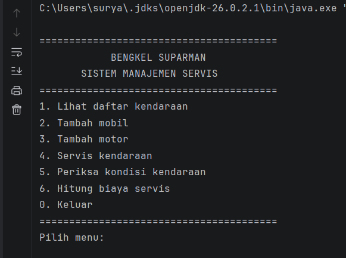
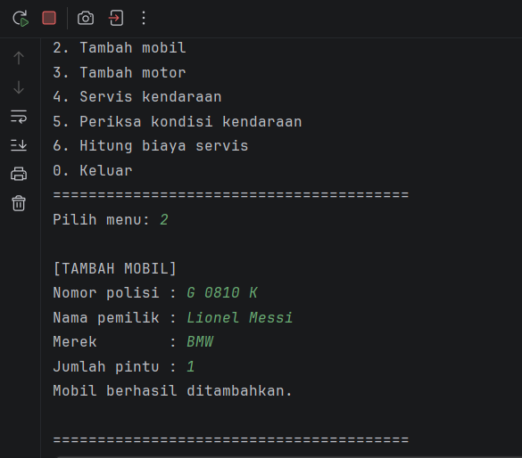
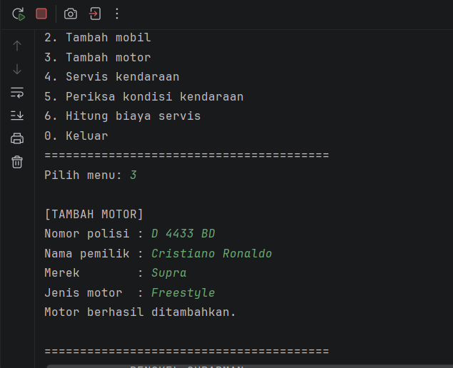
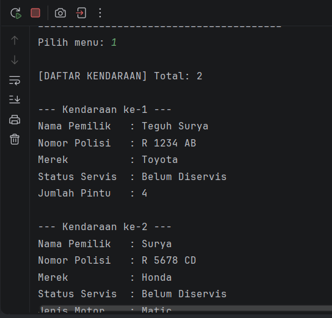
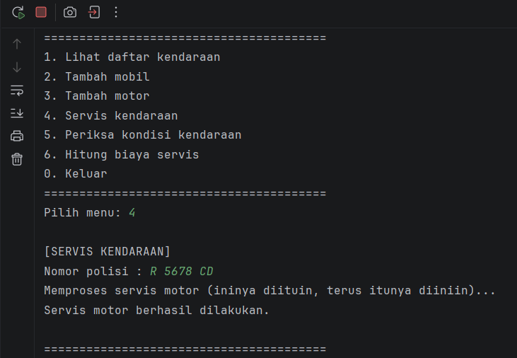
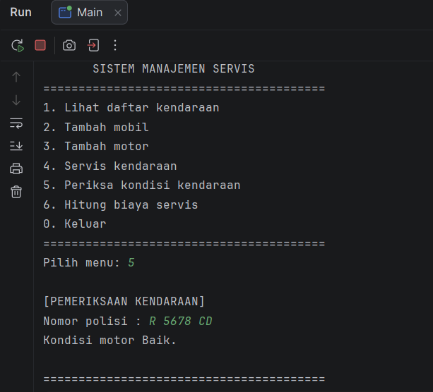
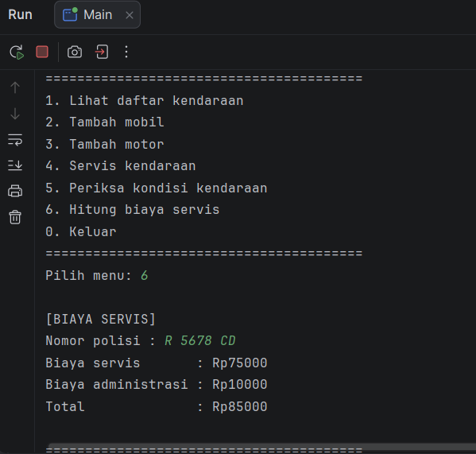

# Sistem Manajemen Servis Bengkel Kendaraan

Responsi Akhir Praktikum Pemrograman Berorientasi Objek (PBO)

## Identitas Mahasiswa

| | |
|---|---|
| Nama | Teguh Surya Romadon |
| NIM | H1D025079 |
| Program Studi | Informatika |
| Universitas | Universitas Jenderal Soedirman |
| Mata Praktikum | Pemrograman Berorientasi Objek |

## Tema NIM

Digit terakhir NIM adalah **9**, sehingga tema sistem adalah **Otomotif**.

Proyek ini berupa aplikasi console bernama **Bengkel Suparman** yang mengelola servis mobil dan motor: menambah kendaraan, melakukan servis, memeriksa kondisi, dan menghitung biaya servis.

## Struktur Proyek

```text
src/
├── app/
│   └── Main.java          # menu utama dan alur pengujian
├── model/
│   ├── Kendaraan.java     # abstract class (superclass)
│   ├── Mobil.java         # subclass
│   └── Motor.java         # subclass
└── layanan/
    ├── Servis.java        # interface biaya servis
    └── Pemeriksaan.java   # interface pemeriksaan kendaraan
```

## Cara Compile dan Run (Terminal)

Prasyarat: JDK sudah terpasang (cek dengan `javac -version`).

1. Buka terminal di folder utama proyek (folder yang berisi `src`).
2. Compile:

   ```bash
   javac -d out -sourcepath src src/app/Main.java
   ```

3. Jalankan:

   ```bash
   java -cp out app.Main
   ```

Setelah dijalankan, pilih menu dengan mengetik angka lalu Enter. Ketik `0` untuk keluar.

## Screenshot Luaran Program

### Menu Utama



### Tambah Mobil



### Tambah Motor



### Daftar Kendaraan



### Proses Servis



### Hasil Pemeriksaan



### Biaya Servis

